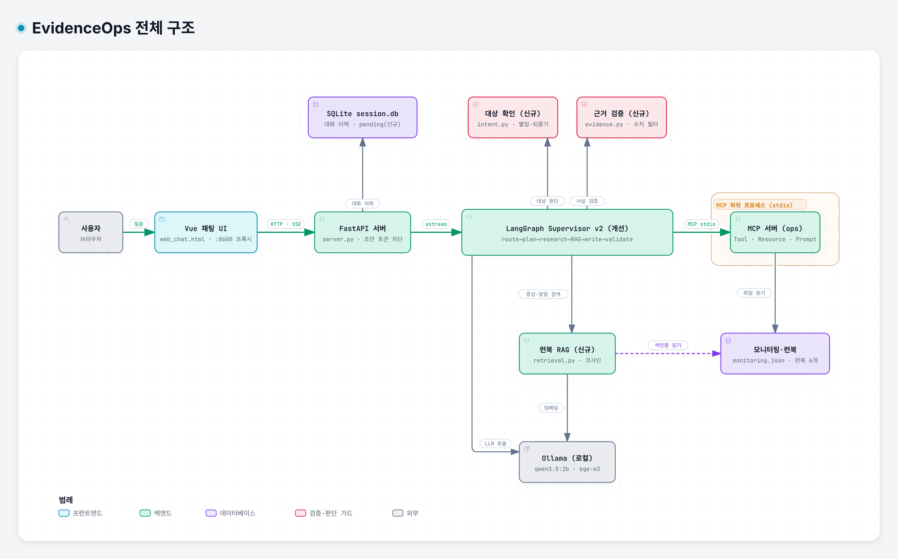
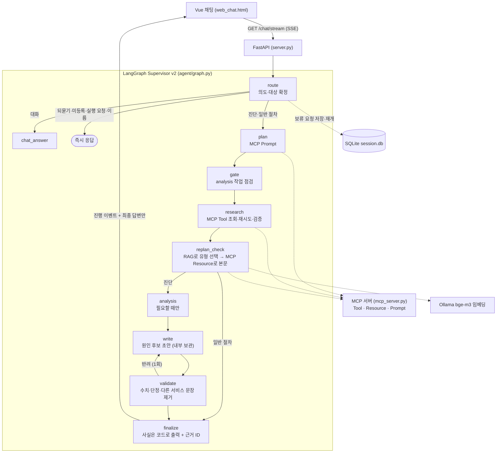

# EvidenceOps — 근거로 말하는 장애 진단 에이전트

> SKALA 광주 2반 · G049 · 박기준
> AI Mini-Project 과제 1 (Base AI Agent 기능 개선) · 2026-10-22
> 저장소: https://github.com/PKJthecreator/skala-evidenceops-agent

[](doc/diagrams/evidenceops-architecture.html)


출발점은 강의에서 받은 운영 인시던트 대응 에이전트 `all_total_vue`입니다. 원본을 직접 돌려 보니 대상 서비스를 근거 없이 골라 버리거나, 모델이 지어낸 수치가 그대로 최종 답변이 되는 경우가 있었습니다. 그래서 목표를 하나로 정했습니다. **사실은 조회한 값으로만 말하고, 모르는 건 모른다고 말하게 하는 것**입니다.

| 목차 | |
|---|---|
| [1. 표지 및 소속 정보](#1-표지-및-소속-정보) | [4. 구현 결과](#4-구현-결과) |
| [2. 문제 개선 및 신규 구현 사항](#2-문제-개선-및-신규-구현-사항) | [5. 교훈](#5-교훈) |
| [3. 적용 기술 요소](#3-적용-기술-요소) | [부록. 실행 방법](#부록-실행-방법) |

---

## 1. 표지 및 소속 정보

| 항목 | 내용 |
|---|---|
| 소속 | SKALA 광주 2반 |
| 고유번호 | G049 |
| 이름 | 박기준 |
| 과제 | 과제 1 — Base AI Agent 기능 개선 |
| 대상 시스템 | 운영 인시던트 대응 에이전트 `all_total_vue` (FastAPI · LangGraph · MCP · Vue) |
| 원본 출처 | SKALA AI Capstone 배포 코드. 받은 그대로 첫 커밋 `cfd5fbe`(태그 `original-baseline`)에 넣어 두었습니다 |
| 프로젝트명 | EvidenceOps |

---

## 2. 문제 개선 및 신규 구현 사항

### 2.1 원본에서 발견한 문제

같은 모델(`qwen3.5:2b`)과 고정된 모니터링 값으로 원본을 돌려 보며 찾은 문제입니다. 실행 기록은 [`results/before.json`](results/before.json)에 있고, 실행 결과가 아니라 코드를 읽고 확인한 항목은 따로 표시했습니다.

1. **대상을 임의로 고릅니다.** 등록되지 않은 `billing-service`를 물었는데 `auth-service`를 조회해서 그 수치로 답했습니다. 서비스 이름이 없는 "응답이 느려요"에도 일단 `auth-service`부터 조회했습니다.
2. **질문에 나온 대상을 빠뜨립니다.** "web-01 CPU 급증, auth-service 커넥션 풀도 같이 확인해줘"라고 했는데 `auth-service`만 조회했습니다.
3. **런북을 키워드로 고릅니다** (코드로 확인). 알림 문구에 latency, cpu 같은 단어가 있는지만 보고 장애 유형을 정하고, 맞는 단어가 없으면 무조건 `db-down` 런북으로 갑니다.
4. **LLM 초안이 그대로 최종 답변이 됩니다.** 틀린 수치를 넣은 초안("CPU 39%", 실제는 91%)을 주입했더니 그대로 최종 답변으로 나갔습니다. 하지도 않은 조치를 "타임아웃을 적용하고 있습니다"처럼 쓴 답변도 있었습니다.
5. **검수 전 초안이 화면에 먼저 보입니다** (코드로 확인). SSE가 작성 중인 초안 토큰을 그대로 흘려보내서, 검수에서 반려될 내용까지 사용자가 보게 됩니다.
6. **조회 하나가 실패하면 요청 전체가 실패합니다.** 두 서비스 중 하나의 조회 실패를 주입하자 `ValueError`로 답변 자체가 나오지 않았습니다.

### 2.2 이렇게 풀기로 했습니다

- 어떤 서비스를 조사할지는 모델이 아니라 코드가 정합니다. 애매하면 되묻고, 등록되지 않은 서비스라면 그렇다고 알려 줍니다.
- 런북은 키워드 대신 의미 기반 검색(RAG)으로 찾고, 근거가 약하면 장애 유형을 단정하지 않습니다.
- CPU·메모리 같은 관측 사실은 조회 결과에서 코드가 직접 출력합니다. LLM의 설명은 검수를 통과한 "원인 후보"로만 씁니다.
- 일부가 실패해도 확보한 근거는 그대로 살리고, 실패하거나 오래된 값은 제한 사항으로 알립니다.

### 2.3 실제로 만든 것

**대상 확인** (`agent/intent.py`, `agent/session_store.py`)
서비스 6개와 한글·영문 별칭(예: 로그인 → `auth-service`)으로 조사 대상을 정합니다. 미등록 서비스는 조회하지 않고 안내만 합니다. 대상이 없으면 되묻고, 그 질문을 SQLite `pending` 테이블에 대화(thread)별로 저장해 두었다가 다음 답이 오면 합쳐서 진단을 이어 갑니다. 재시작·롤백을 실제로 해 달라는 요청에는 지원 범위를 안내합니다.

**런북 RAG** (`agent/retrieval.py`, `agent/graph.py`)
런북 6개를 `bge-m3`로 임베딩해 메모리에 두고, 코사인 유사도가 가장 높은 런북을 고릅니다. 점수가 0.55보다 낮으면 "맞는 런북 없음"으로 처리합니다. 검색은 장애 유형을 고르는 데만 쓰고, 본문은 원본에 있던 MCP Resource `runbook://incident-response/{유형}`으로 읽습니다. 대상이 둘 이상이면 대상별로 따로 검색해서 다른 서비스의 근거가 섞이지 않게 했습니다. `db-down` 기본값은 없앴습니다.

**근거 기반 응답** (`agent/evidence.py`)
상태·CPU·메모리·관측 시각·알림은 MCP 조회값을 검증한 뒤 코드가 출력하고, 근거 ID(`[E1]`)를 붙입니다. LLM 설명에서는 숫자, 상태 단정, 다른 서비스 언급, 내용 없는 문장을 걸러 냅니다. 걸러진 게 있으면 한 번만 다시 쓰게 하고, 그래도 안 되면 걸러진 문장을 빼고 확인된 사실만 내보냅니다. 원본처럼 실패한 초안을 "통과"로 바꿔 주지 않습니다.

**초안 노출 차단** (`server.py`, `web_chat.html`)
SSE로는 진행 이벤트와 검증을 마친 최종 답변만 보냅니다. 초안 토큰은 보내지 않습니다.

**오류 처리** (`agent/graph.py`, `agent/mcp_client.py`)
대상별 조회를 따로 감싸서, 하나가 실패해도 성공한 근거는 남깁니다. 관측 시각이 5분 넘게 지난 값은 "오래된 값"으로 표시하고 진단 입력에서 뺍니다. 호출마다 시간 상한을 두었고(MCP 5초, 임베딩 60초, LLM 120초), 재시도는 원본의 `with_retry` 그대로 타임아웃일 때만 최대 3번까지 시도합니다(재시도 2회). MCP가 `isError`를 돌려주면 실패로 처리합니다.

**Windows 실행과 평가 도구** (`sh/*.ps1`, `eval/run_eval.py`, `sh/export_chat.py`)
원본은 맥용 `.sh`만 있어서 PowerShell 설치·실행 스크립트를 추가했습니다. 원본과 개선판을 같은 조건으로 돌리는 14개 시나리오 비교 실행기와, 대화 기록을 Markdown으로 뽑는 스크립트도 만들었습니다.

---

## 3. 적용 기술 요소

원본에 이미 있던 기능과 이번에 바꾸거나 더한 부분을 나눠서 적었습니다.

### Multi-Agent & LangGraph

원본은 `StateGraph` 기반 Supervisor 구조입니다. route → plan → gate → research → replan_check → analysis → write → validate → finalize 노드가 있고, 노드는 `functools.partial`로 의존성을 주입받는 순수 함수입니다.

이번에는 route를 의도별 분기(대화, 되묻기, 진단, 일반 절차, 지원 범위 밖)로 넓혔습니다. validate는 원본이 초안을 최대 3번까지 쓰고 그래도 안 되면 통과시키던 것을, 재작성 1번만 허용하고 실패한 초안은 승인하지 않게 바꿨습니다.

솔직하게 적어 두면, 원본의 동적 재계획(런북이 없으면 research로 돌아가 다시 조사)은 지금 실행되지 않습니다. 첫 조사에서 RAG로 런북을 확보하기 때문이고, 그래프의 간선만 남아 있습니다. gate도 노드는 남아 있지만, 이제 plan이 정말 필요할 때만 analysis 작업을 넣기 때문에 14개 시나리오에서 gate가 걸러 낸 작업은 0건이었습니다. 전문 서브에이전트를 별도 subgraph로 나누는 작업도 하지 않았습니다.

### MCP

원본에는 `fastmcp` 서버를 stdio 하위 프로세스로 한 번 띄워 재사용하는 구조가 이미 있었습니다. **Tool** `get_monitoring_status`(동적 조회), **Resource** `runbook://incident-response/{type}`(런북 본문), **Prompt** `incident_analysis_prompt`(진단 절차)가 있고, 클라이언트는 연결된 서버 2개(ops, docs) 중에서 해당 prompt와 resource를 가진 서버를 찾아 씁니다.

이번에는 RAG가 고른 런북 유형으로 Resource 본문을 읽도록 연결했고, MCP 호출마다 5초 상한과 `isError` 처리를 넣었습니다.

### RAG

원본에는 검색이 없었습니다. 이번에 Ollama `bge-m3` 임베딩과 정규화한 코사인 유사도로 런북을 고르고, 고른 본문을 작성 프롬프트와 최종 답변에 넣었습니다. 비정상 벡터, 차원 불일치, 점수 미달은 "근거 없음"으로 처리합니다. 문서가 6개뿐이라 별도 Vector DB는 쓰지 않고 메모리에 색인했습니다.

### 아키텍처와 코드 품질

원본에 이미 `SupervisorDeps` + `partial` 의존성 주입이 있어서, 노드를 다시 쪼개는 리팩터링은 하지 않았습니다. 대신 새 판단 로직은 노드 밖 모듈로 뺐습니다. `intent.py`는 대상 판단, `retrieval.py`는 검색, `evidence.py`는 사실 검증과 답변 렌더링을 맡고, 노드에는 흐름만 남겼습니다. 검색기도 `SupervisorDeps`로 주입합니다. 테스트는 표준 `unittest` 21개로 대상 판단, 사실 검증, 검색, 보류 요청, 부분 실패, SSE를 확인하고, 그래프·SSE 테스트에는 모의 MCP/LLM을 씁니다.

### 관측 가능성과 평가

노드, LLM 호출, MCP 호출의 LangSmith `@traceable`은 원본에 이미 있었고, 이번에 런북 검색 단계(`runbook_search` retriever span)를 더했습니다. 트레이싱은 기본으로 꺼져 있고 `.env`에 키를 넣었을 때만 기록됩니다. 평가는 고정된 모니터링 값과 장애 주입(틀린 초안, 조회 실패)을 쓰는 14개 시나리오 Before/After 실행기로 했습니다. LLM-as-a-Judge는 적용하지 못했습니다.

### 기타

SSE 스트리밍, SQLite 대화 이력, 타임아웃 재시도(backoff), fast/quality 모델 분리 구조, `SUPERVISOR_VERSION`으로 v1/v2 전환, Vue 3 채팅 화면은 원본에 있던 기능입니다. 이번에는 SSE 초안 토큰 차단, 보류 요청(`pending`) 저장, Windows 실행 스크립트를 더했습니다.

---

## 4. 구현 결과

### 4.1 노드 흐름

맨 위 그림이 시스템 전체라면, 아래는 LangGraph 안에서 질문 하나가 지나가는 길입니다.



원본과 비교하면 노드별로 이렇게 달라졌습니다.

| 노드 | 원본 | 개선판 |
|---|---|---|
| route | chat/incident 두 갈래 | 대상 확정, 미등록 안내, 되묻기, 실행 요청 안내, 이름 기억 추가 |
| plan | LLM이 정한 대상을 조사(없으면 auth-service) | 코드가 확정한 대상만 조사, analysis는 필요할 때만 추가 |
| research | 한 대상이 실패하면 전체 실패 | 대상별로 격리, 조회값 형식·범위·시각 검증 |
| replan_check | 키워드로 런북 유형 결정, 기본값 `db-down`, 없으면 재조사 | RAG로 유형 선택 → MCP Resource로 본문. 재조사 루프는 돌지 않음 |
| validate | 30자 이상·"1)" 포함만 검사, 3회 실패하면 통과 처리 | 생성 수치·단정·다른 서비스 문장 제거, 재작성 1회, 실패 초안은 승인 안 함 |
| finalize / SSE | LLM 초안이 곧 최종 답변, 초안 토큰 스트리밍 | 사실은 코드가 출력, 초안 토큰 차단 |

### 4.2 Before/After 실측

2026-10-21에 같은 모델 `qwen3.5:2b`(temperature 0, ctx 8192, predict 700, think false)로 같은 질의 14개를 원본과 개선판에 돌렸습니다. 시나리오별 표는 [`results/before_after.md`](results/before_after.md)에 있습니다.

| 지표 | Before | After |
|---|---|---|
| 의도하지 않은 대상 조회 (미등록·되묻기 시나리오) | 2건 | **0건** |
| 질문에 나온 대상 누락 | 1건 | **0건** |
| 틀린 수치 초안("CPU 39%")이 최종 답변에 노출 | 노출 | **차단** (조회값 91.0%만 표시) |
| 조회 하나가 실패했을 때 | 오류 | **부분 응답** + 실패 안내 |
| 런북 선택이 기대와 일치 (진단 11개) | 비교 불가 (검색 없음) | 9/11 |
| 평균 응답 시간 (양쪽 모두 완료한 13개) | 22.1초 | 24.4초 (**+10%, 느려짐**) |

측정 조건에서 미리 밝혀 둘 점이 있습니다.

- 평가 실행기(`eval/run_eval.py`)는 실제 MCP 서버를 띄우지 않습니다. 고정 응답 객체(`FixedMCP`)가 양쪽에 같은 모니터링 값, 같은 런북 본문, 간단한 고정 Prompt를 돌려줍니다. MCP 서버를 거친 실제 실행은 시연 기록(`results/screenshot_fix_smoke.*`)으로 따로 확인했습니다.
- 원본 코드는 Windows 인코딩 문제(`read_text()`)만 똑같이 고쳐서 돌렸습니다. 원본에는 조회마다 교육용으로 넣은 0.35초 대기가 남아 있고 개선판은 이를 뺐습니다. 그래서 시간 비교가 완전히 같은 조건은 아닌데, 그런데도 개선판이 더 느렸습니다.
- 런북 6개는 첫 단계 문구를 실제 도구가 주는 정보에 맞게 고쳤고, 양쪽 모두 고친 런북으로 측정했습니다.
- 14개를 한 번씩 돌린 결과라, 일반적인 정확도로 읽으면 안 됩니다.

### 4.3 주요 기능 시연

아래는 개선판의 실제 출력입니다(평가용 고정 모니터링 값). 화면에서는 `http://localhost:8600`의 Vue 채팅이 같은 답변과 진행 이벤트를 보여 줍니다.

**① 대상을 되묻고, 같은 대화에서 이어서 진단**

```text
사용자: 응답이 느려요
에이전트: 어느 서비스인가요? 등록된 서비스: auth-service, web-01, payments-service, cache-service, gateway-service, log-service
사용자: payments-service야
에이전트:
확인된 사실
[E1] payments-service: 상태=degraded, CPU 91.0%, 메모리 55.0%, 관측 2026-10-20T00:00:00+00:00, 알림: CPU 91% (threshold 80%); payments-service-3 instance responding slow

참고 런북
[E2] payments-service / high-latency — Runbook: 응답 지연(High Latency) 대응 절차 (참고 절차)
...
```

원본은 같은 대화에서 `auth-service`와 `payments-service`를 둘 다 조회했고, 개선판은 `payments-service`만 조회합니다. 다만 이 장면의 런북은 기대한 `cpu-spike`가 아니라 `high-latency`가 골라졌습니다. "느려요"라는 질문이라 틀린 문서는 아니지만, 11개 중 기대와 달랐던 2건 가운데 하나입니다.

**② 미등록 서비스는 다른 서비스로 대신 답하지 않음**

```text
사용자: billing-service 응답이 느려요
에이전트: 미등록 서비스: billing-service. 등록된 서비스명을 확인해 주세요: auth-service, web-01, payments-service, cache-service, gateway-service, log-service
```

원본은 여기서 `auth-service`를 조회해 "p95 2.4s, 커넥션 풀 92%"로 답했습니다.

**③ 틀린 수치 초안 차단** (작성 LLM이 "payments-service CPU 39%입니다"라는 초안을 내도록 주입)

```text
확인된 사실
[E1] payments-service: 상태=degraded, CPU 91.0%, 메모리 55.0%, ...
참고 런북
[E2] payments-service / cpu-spike — Runbook: CPU 급증 대응 절차 (참고 절차)
- get_monitoring_status로 현재 CPU 사용률과 알림을 확인한다. ...
- 반복 호출, 배치 작업 중복 실행 같은 특정 요청 패턴이 원인인지 최근 로그에서 확인한다.
원인 판단
현재 근거만으로 원인을 특정할 수 없습니다. 참고 런북의 점검 항목을 확인해 주세요.
```

두 번 쓴 초안이 모두 검수에서 걸렸고, 조회값만 남았습니다. 원본은 "CPU 39%"를 그대로 최종 답변으로 냈습니다.

**④ 대상이 둘일 때: 대상별 런북 검색과 진행 이벤트(SSE)**

```text
사용자: payments-service랑 cache-service 둘 다 저하됐는데 공통 원인이 있는지 분석해줘
진행 이벤트:
  RouteDecided(diagnose: cache-service, payments-service) → PlanCreated(3) → GateApplied
  → TaskCompleted(cache-service) → TaskCompleted(payments-service)
  → RetrievalCompleted(cache-service: memory-leak) → RetrievalCompleted(payments-service: cpu-spike)
  → AnalysisCompleted → DraftWritten(1) → Validation(불합격) → DraftWritten(2) → Validation(제한 응답) → Finalize
최종 답변: [E1] cache-service 사실, [E2] payments-service 사실, [E3] memory-leak 런북, [E4] cpu-spike 런북, 원인 판단 보류
```

**⑤ 조회 하나가 실패해도 성공한 근거는 보존** (`cache-service` 조회 실패 주입)

```text
확인된 사실
[E2] payments-service: 상태=degraded, CPU 91.0%, 메모리 55.0%, ...
참고 런북
[E3] payments-service / cpu-spike — ...
제한 사항
cache-service: 모니터링 미확보 (ValueError)
```

원본은 같은 상황에서 `ValueError`로 아무 답도 하지 못했습니다.

**⑥ 일반 절차 질문은 현재 장애 진단과 구분** (시연 기록 `results/screenshot_fix_smoke.json`)

```text
사용자: DB 다운 절차 알려줘
에이전트:
일반 대응 절차입니다. 현재 장애나 원인을 확인한 결과는 아닙니다.

참고 런북
[E1] 일반 절차 / db-down — Runbook: DB Down 대응 절차 (참고 절차)
- 등록된 서비스의 현재 상태와 알림은 get_monitoring_status로 확인한다. DB 장애 여부는 별도 DB 모니터링에서 확인한다.
- 커넥션 풀/리플리케이션 상태를 점검하고 필요 시 failover 노드로 전환한다.
- 서비스 정상화 확인 후 원인 분석과 재발 방지 대책을 문서화한다.
```

**⑦ 대화 기억** — "제 이름은 민수입니다" → "제 이름이 뭐였죠?" → "민수님이라고 알려주셨습니다." 같은 대화에서 사용자가 한 말만 보고 이름을 찾습니다.

---

## 5. 교훈

### 5.1 한계와 트레이드오프

고친 만큼 새로 생긴 약점도 있습니다.

- **응답이 느려졌습니다.** 평균 22.1초에서 24.4초로 10% 늘었고, 대상이 둘인 질문은 약 25초에서 42~51초까지 걸렸습니다. 대상별 검색과 검수 단계가 늘어난 값이고, 정확성과 안전성을 위해 감수한 부분입니다.
- **임베딩 점수 차이가 작습니다.** cache 단일 질문에서 cpu-spike 0.544, memory-leak 0.530이 나와 둘 다 기준 0.55를 넘지 못했고, 런북을 하나도 제시하지 못했습니다. 문서끼리 비슷하면 순위가 쉽게 뒤바뀌어서 임계값 하나로는 해결되지 않습니다.
- **문장 필터가 보수적입니다.** 숫자나 단정 표현이 있으면 LLM 설명이 대부분 지워져서 "원인을 특정할 수 없습니다"가 자주 나옵니다. 틀린 말은 막지만 설명이 덜 유용해졌고, 규칙 기반이라 인과관계가 맞는지까지는 보지 못합니다.
- **대상별로 런북을 하나만, 첫 알림 기준으로 고릅니다.** 여러 유형이 겹친 장애를 다 찾지는 못합니다.
- **처리하는 표현이 제한적입니다.** 별칭과 이름 소개는 몇 가지 패턴만 지원하고, 그 밖의 표현은 되묻기로 넘어갑니다.
- **MCP 호출은 여전히 하나씩 처리됩니다.** 원본 클라이언트의 Lock을 그대로 둬서, 코드는 `asyncio.gather`지만 실제 호출은 직렬입니다.
- **평가 규모가 작습니다.** 14개 시나리오를 한 번씩 돌렸고, 모니터링 값은 합성 데이터입니다.

### 5.2 앞으로 더 해 보고 싶은 것

1. 검색 품질: BM25 + 임베딩 Hybrid(RRF), 런북에 장애 유형·증상 메타데이터 달기, 여러 런북 함께 고르기
2. 평가: LLM-as-a-Judge로 "수집한 수치를 정확히 인용했는가" 채점, LangSmith 데이터셋으로 회귀 평가
3. 안전한 조치: LangGraph `interrupt()`로 재시작·롤백 제안 전에 사람 승인 받기(HITL)
4. 멀티 에이전트: research를 메트릭·로그·런북 전문 서브그래프로 나누기
5. 성능: 대상별 검색·조회 병렬화, 문서가 늘면 영속 Vector DB로 옮기기
6. 설명 품질: 문장 필터를 근거 인용 검증 방식으로 바꿔서 쓸 만한 원인 후보를 더 남기기

### 5.3 해 보면서 느낀 점

작은 로컬 모델은 그럴듯한 수치와 조치를 생각보다 쉽게 지어냈습니다. 프롬프트로 "정확하게 써라"라고 하는 것보다, 사실은 코드가 말하고 모델은 후보만 말하게 역할을 나누는 쪽이 훨씬 확실했습니다.

개선했다고 모든 숫자가 좋아지지는 않았습니다. 응답은 10% 느려졌고 설명은 줄었습니다. 같은 조건에서 재서 얻은 것과 잃은 것을 같이 보여 주는 게 오히려 설득력이 있다는 걸 이번에 배웠습니다.

문서가 6개뿐인 RAG에서도 유사도 차이가 0.01 수준이라 결과가 뒤집히는 걸 보면서, 검색은 붙이면 끝나는 게 아니라 데이터와 질의를 같이 다듬어야 하는 일이라는 걸 느꼈습니다.

코딩에는 AI 도구(Codex, Claude Code)를 적극적으로 썼습니다. 대신 바꿀 때마다 테스트와 실측으로 확인했고, 노드와 필터 하나하나를 직접 설명할 수 있을 때까지 정리했습니다.

---

## 부록. 실행 방법

### 실행 (Windows, Python 3.12)

```powershell
.\sh\setup_venv.ps1                 # .venv 생성 + 의존성 설치 + 테스트
ollama pull qwen3.5:2b
ollama pull bge-m3                  # 런북 검색용 임베딩
.\sh\run.ps1 -Backend ollama        # 백엔드 http://localhost:8100/docs
.\sh\run.ps1 -Frontend              # 다른 터미널, 채팅 http://localhost:8600
```

- `-Backend fake`는 생성 모델 없이 흐름만 확인할 때 씁니다. `-Backend openai`는 `.env`의 `OPENAI_API_KEY`를 쓰고 요금이 나갑니다. 키는 `.env`에만 둡니다.
- 실행 정책 때문에 ps1이 막히면 `.venv\Scripts\python.exe server.py`와 `web_demo_server.py`를 각각 실행하면 됩니다.
- macOS/Linux에서는 원본 방식대로 `bash sh/run_agent_ollma.sh`, `bash sh/run_frontend.sh`를 쓸 수 있습니다. 이 스크립트는 실행할 때 `session.db`를 지웁니다.
- LangSmith 추적은 `.env`에 `LANGCHAIN_TRACING_V2=true`와 `LANGCHAIN_API_KEY`를 넣으면 켜집니다.

### 검증

```powershell
.\.venv\Scripts\python.exe -m unittest discover -s tests -v                                  # 단위 테스트 21개
.\.venv\Scripts\python.exe eval\run_eval.py --backend ollama --out results\after.json             # 개선판 14개 시나리오
New-Item -ItemType Directory -Force .tools | Out-Null                                          # 원본 비교용 압축 만들기 (처음 한 번)
git archive --format=zip -o .tools\original-baseline.zip original-baseline
.\.venv\Scripts\python.exe eval\run_eval.py --backend ollama --baseline --out results\before.json # 원본 14개 시나리오
.\.venv\Scripts\python.exe sh\export_chat.py                                                  # 대화 기록 → results/chat_history.md
```

`.tools/` 폴더는 Git에 올라가지 않으므로, 원본 비교를 하려면 위의 두 줄로 압축을 먼저 만들어야 합니다. 원본 코드 자체는 첫 커밋 `cfd5fbe`(태그 `original-baseline`)에 있습니다.

### 저장소 구조

```text
agent/
  graph.py          LangGraph Supervisor v2 (노드·분기)
  intent.py         대상·별칭·미등록·의도 판단          ← 신규
  retrieval.py      런북 임베딩 검색                    ← 신규
  evidence.py       조회값 검증, 문장 필터, 답변 렌더링  ← 신규
  mcp_client.py     MCP stdio 클라이언트 (Tool/Resource/Prompt)
  session_store.py  SQLite 대화·보류 요청
  deps.py           SupervisorDeps (의존성 주입)
  ollama_llm.py / openai_llm.py / fake_llm.py   LLM 백엔드
mcp_server.py       MCP 서버 (모니터링 Tool, 런북 Resource, 진단 Prompt)
server.py           FastAPI (/chat, /chat/stream SSE)
web_chat.html       Vue 3 채팅 UI
data/               모니터링 샘플, 런북 6개
doc/diagrams/       전체 구조 다이어그램 (PNG, Archify HTML, 원본 JSON)  ← 신규
eval/run_eval.py    Before/After 14개 시나리오 실행기   ← 신규
tests/test_core.py  단위·그래프·SSE 테스트 21개          ← 신규
results/            Before/After 결과와 실행 기록
```

### 관련 문서

- [개선 계획과 작업 기록](AI-Mini-Project_과제1_개선계획.md)
- [진행 기록](doc/progress.md) · [캡처 검토](doc/screenshot_review.md)
- [Before/After 상세](results/before_after.md)
- [발표 PPT 제작 계획](AI-Mini-Project_과제1_PPT제작계획.md)
