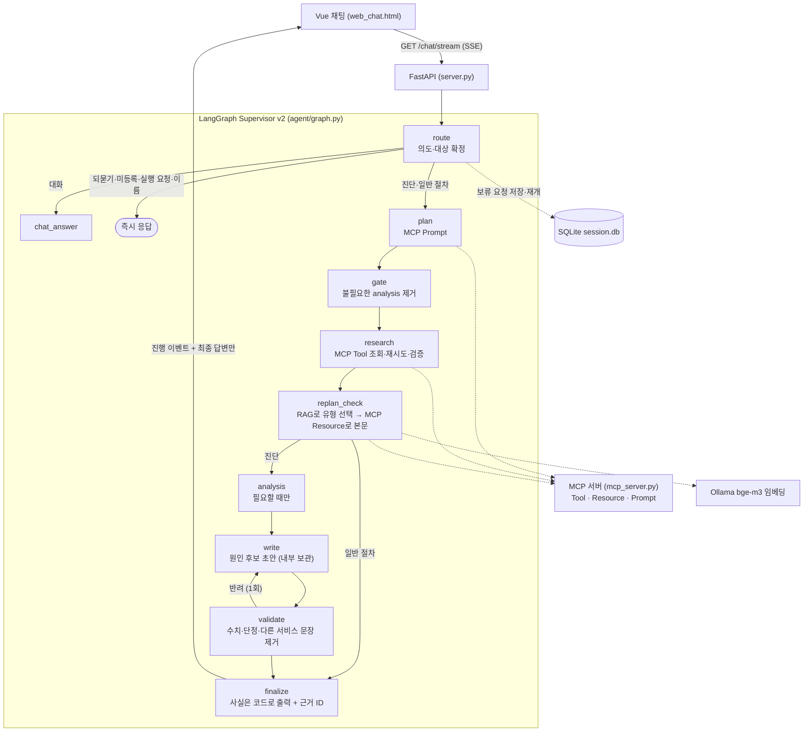

# EvidenceOps — 근거로 말하는 장애 진단 에이전트

> **SKALA 광주 2반 · G049 · 박기준**
> AI Mini-Project 과제 1 — Base AI Agent(`all_total_vue`) 기능 개선 · 2026-10-22
> 저장소: https://github.com/PKJthecreator/skala-evidenceops-agent

**한 줄 요약** — 대상 서비스를 임의로 고르지 않고, 조회한 모니터링 값과 런북 근거로만 사실을 말하는 장애 진단 에이전트로 개선했다.

| 목차 | |
|---|---|
| [1. 표지 및 소속 정보](#1-표지-및-소속-정보) | [4. 구현 결과](#4-구현-결과) |
| [2. 문제 개선 및 신규 구현 사항](#2-문제-개선-및-신규-구현-사항) | [5. 교훈](#5-교훈) |
| [3. 적용 기술 요소](#3-적용-기술-요소) | [부록. 실행 방법](#부록-실행-방법) |

---

## 1. 표지 및 소속 정보

| 항목 | 내용 |
|---|---|
| 소속 | SKALA 광주 2반 |
| 고유번호 | G049 |
| 이름 | 박기준 |
| 과제 | 과제 1 — Base AI Agent 기능 개선 |
| 대상 시스템 | 운영 인시던트 대응 에이전트 `all_total_vue` (FastAPI · LangGraph · MCP · Vue) |
| 프로젝트명 | EvidenceOps |

---

## 2. 문제 개선 및 신규 구현 사항

### 2.1 기존 시스템의 문제점

같은 모델(`qwen3.5:2b`)과 고정 데이터로 원본을 실행해 확인한 문제다. 근거는 [`results/before.json`](results/before.json)에 있다.

| # | 문제 | 원본에서 실제로 일어난 일 |
|---|---|---|
| 1 | **대상을 임의로 고름** | 등록되지 않은 `billing-service` 질문에 `auth-service`를 조회해 그 수치로 답했다. 대상이 없는 “응답이 느려요”에도 `auth-service`를 먼저 조회했다. |
| 2 | **언급한 대상을 빠뜨림** | “web-01 CPU 급증, auth-service 커넥션 풀도 같이 확인해줘”에서 `auth-service`만 조회했다. |
| 3 | **키워드 기반 런북 매핑** | 알림 문구의 키워드로 장애 유형을 정하고, 맞는 키워드가 없으면 무조건 `db-down` 런북으로 돌아갔다. |
| 4 | **LLM 초안을 그대로 최종 답변으로 사용** | 틀린 수치를 넣은 초안(“CPU 39%”, 실제 91%)이 그대로 최종 답변이 됐다. 실행하지 않은 조치를 “타임아웃을 적용하고 있습니다”처럼 서술하기도 했다. |
| 5 | **검증 전 초안이 먼저 노출** | SSE가 작성 중인 초안 토큰을 그대로 화면에 흘려보내, 검수에서 반려될 내용도 사용자에게 보였다. |
| 6 | **일부 조회 실패 시 전체 실패** | 두 서비스 중 하나의 조회가 실패하면 `ValueError`로 요청 전체가 실패했다. |

### 2.2 해결 과제

1. 조사 대상은 **코드가 확정**한다. 모호하면 되묻고, 등록되지 않은 서비스는 안내한다.
2. 런북은 키워드 대신 **의미 기반 검색(RAG)** 으로 찾고, 근거가 부족하면 장애 유형을 단정하지 않는다.
3. 관측 사실은 **조회 결과에서 직접** 표시하고, LLM의 설명은 검증을 통과한 “원인 후보”로만 쓴다.
4. 일부가 실패해도 **확보한 근거는 보존**하고, 실패·오래된 값은 제한 사항으로 알린다.

### 2.3 구현·개선한 핵심 기능

| 기능 | 구현 내용 | 주요 파일 |
|---|---|---|
| **대상 확인** | 서비스 카탈로그(6개)와 한글·영문 별칭(예: 로그인 → `auth-service`)으로 대상을 확정한다. 미등록 서비스는 조회하지 않고 안내한다. 대상이 없으면 되묻고, 보류한 요청을 SQLite `pending` 테이블에 thread별로 저장했다가 다음 답변과 합쳐 진단을 이어간다. 실제 재시작·롤백 실행 요청에는 지원 범위를 안내한다. | `agent/intent.py`, `agent/session_store.py` |
| **런북 RAG** | 런북 6개를 `bge-m3`로 임베딩해 메모리에 두고 코사인 유사도로 장애 유형을 고른다(최소 점수 0.55). 본문은 기존 MCP Resource `runbook://incident-response/{유형}`으로 읽는다. 복수 대상이면 대상별로 따로 검색해 서비스 간 근거가 섞이지 않게 한다. `db-down` 기본값은 제거했다. | `agent/retrieval.py`, `agent/graph.py` |
| **근거 기반 응답** | 상태·CPU·메모리·관측 시각·알림은 MCP 조회 결과를 검증한 뒤 코드로 출력하고 근거 ID(`[E1]`)를 붙인다. LLM 설명에서 숫자·상태 단정·다른 서비스 언급·내용 없는 문장을 제거하고, 반려되면 1회 재작성한다. 실패한 초안은 자동 승인하지 않는다. | `agent/evidence.py` |
| **초안 노출 차단** | SSE는 진행 이벤트와 검증된 최종 답변만 보낸다. 초안 토큰은 보내지 않는다. | `server.py`, `web_chat.html` |
| **오류 처리** | 대상별 조회를 격리해 일부 실패가 성공한 근거를 지우지 않게 했다. 5분 넘은 관측은 오래된 값으로 표시하고 진단 입력에서 뺀다. 호출마다 상한을 둔다(MCP 5초, 임베딩 60초, LLM 120초). 재시도는 타임아웃일 때만 최대 3회 한다. MCP `isError` 결과는 실패로 처리한다. | `agent/graph.py`, `agent/retry.py`, `agent/mcp_client.py` |
| **Windows 실행·평가 도구** | PowerShell 설치·실행 스크립트를 추가하고, 원본/개선판 14개 시나리오 비교 실행기를 만들었다. 대화 기록을 Markdown으로 내보내는 스크립트도 추가했다. | `sh/*.ps1`, `eval/run_eval.py`, `sh/export_chat.py` |

---

## 3. 적용 기술 요소

| 분류 | 적용 내용 | 수준 |
|---|---|---|
| **Multi-Agent & LangGraph** | `StateGraph` Supervisor 패턴. route → plan → gate → research → replan_check → analysis → write → validate → finalize의 역할 노드로 구성했다. 동적 분기는 세 가지다: 의도별 분기(대화·되묻기·진단·일반 절차), gate가 불필요한 analysis 작업을 코드로 제거, validate 반려 시 write로 되돌아가는 재작성 루프(1회). 노드는 `functools.partial`로 의존성을 주입받는 순수 함수다. | 적용 (전문 서브에이전트를 별도 compiled subgraph로 분리하지는 않음) |
| **MCP** | `fastmcp` 서버를 stdio subprocess로 1회 기동해 재사용한다. **Tool** `get_monitoring_status`(동적 조회), **Resource** `runbook://incident-response/{type}`(런북 본문), **Prompt** `incident_analysis_prompt`(진단 표준 절차)를 모두 실제 흐름에서 쓴다. 클라이언트는 연결된 서버 2개(ops·docs)에서 prompt·resource를 탐색해 찾는다. | 적용 |
| **RAG** | Ollama `bge-m3` 임베딩, 정규화 코사인 유사도, 최소 점수 기준. 검색 결과(장애 유형)로 MCP Resource에서 본문을 읽어 작성 프롬프트와 최종 답변에 주입한다. 비정상 벡터·차원 불일치·점수 미달은 “근거 없음”으로 처리한다. | 적용 (문서 6개 규모라 별도 Vector DB 없이 메모리 색인) |
| **아키텍처·코드 품질** | 판단 로직을 모듈로 분리했다(`intent.py` 대상 판단, `retrieval.py` 검색, `evidence.py` 사실 검증·렌더링). 노드에는 흐름만 남겼다. 검색기도 `SupervisorDeps`로 주입한다. 표준 `unittest` 21개로 대상 판단·사실 검증·검색·보류·부분 실패·SSE를 확인하며, 그래프·SSE 테스트는 모의 MCP/LLM을 쓴다. | 적용 |
| **관측 가능성·평가** | 모든 노드·LLM 호출·MCP 호출·런북 검색(`runbook_search` retriever span)에 LangSmith `@traceable`을 걸었다. 기본은 비활성이고 `.env`에 키를 넣으면 요청별 계층 트리로 기록된다. 평가는 고정 모니터링 snapshot과 장애 주입(틀린 초안, 조회 실패)을 쓰는 14개 시나리오 Before/After 실행기로 했다. | LangSmith 적용 / **LLM-as-a-Judge는 미적용**(향후 과제) |
| **기타** | SSE 스트리밍(진행 이벤트), SQLite 세션·보류 요청(재시작 후에도 유지), 타임아웃 재시도 backoff, fast/quality 모델 분리 구조, `SUPERVISOR_VERSION`으로 v1/v2 즉시 전환, Vue 3 채팅 UI | 적용 |

---

## 4. 구현 결과

### 4.1 아키텍처 흐름도



원본 대비 바뀐 노드는 다음과 같다.

| 노드 | 원본 | 개선 |
|---|---|---|
| route | chat/incident 2분기 | 대상 확정·미등록·되묻기·실행 요청·이름 처리 추가 |
| plan | LLM이 정한 대상을 조사(없으면 auth-service) | 코드가 확정한 대상만 조사 |
| research | 한 대상 실패 시 전체 실패 | 대상별 격리, 조회값 형식·범위·시각 검증 |
| replan_check | 키워드 → 런북 유형, 기본값 `db-down` | RAG로 유형 선택 → MCP Resource로 본문 |
| validate | 30자 이상·“1)” 포함만 검사, 3회 실패하면 통과 처리 | 생성 수치·단정·다른 서비스 문장 제거, 실패 초안은 승인하지 않음 |
| finalize / SSE | LLM 초안이 곧 최종 답변, 초안 토큰 스트리밍 | 사실은 코드로 출력, 초안 토큰 차단 |

### 4.2 Before/After 실측

조건: 같은 모델 `qwen3.5:2b`(temperature 0, ctx 8192, predict 700), 같은 질의 14개, 고정 모니터링 값, 같은 런북. 2026-10-21에 측정했다. 상세 표는 [`results/before_after.md`](results/before_after.md)에 있다.

| 지표 | Before | After |
|---|---|---|
| 의도하지 않은 대상 조회 (미등록·되묻기 시나리오) | 2건 | **0건** |
| 질문에 나온 대상 누락 | 1건 | **0건** |
| 틀린 수치 초안(“CPU 39%”)이 최종 답변에 노출 | 노출 | **차단** (조회값 91.0%만 표시) |
| 일부 조회 실패 시 응답 | 오류 | **부분 응답** + 실패 안내 |
| 런북 선택이 기대와 일치 (진단 11개) | 비교 불가 (검색 없음) | 9/11 |
| 평균 응답 시간 (양쪽 모두 완료한 13개) | 22.1초 | 24.4초 (**+10%, 느려짐**) |

### 4.3 주요 기능 시연 결과

아래는 개선판의 실제 실행 출력이다(평가용 고정 모니터링 값). 화면 UI는 `http://localhost:8600`의 Vue 채팅에서 같은 결과와 진행 이벤트를 보여준다.

**① 대상 되묻기 → 같은 대화에서 이어서 진단**

```text
사용자: 응답이 느려요
에이전트: 어느 서비스인가요? 등록된 서비스: auth-service, web-01, payments-service, cache-service, gateway-service, log-service
사용자: payments-service야
에이전트:
확인된 사실
[E1] payments-service: 상태=degraded, CPU 91.0%, 메모리 55.0%, 관측 2026-10-20T00:00:00+00:00, 알림: CPU 91% (threshold 80%); payments-service-3 instance responding slow

참고 런북
[E2] payments-service / high-latency — Runbook: 응답 지연(High Latency) 대응 절차 (참고 절차)
...
```

원본은 같은 대화에서 `auth-service`와 `payments-service`를 모두 조회했다. 개선판은 `payments-service`만 조회한다.

**② 미등록 서비스 — 다른 서비스로 대신 답하지 않음**

```text
사용자: billing-service 응답이 느려요
에이전트: 미등록 서비스: billing-service. 등록된 서비스명을 확인해 주세요: auth-service, web-01, payments-service, cache-service, gateway-service, log-service
```

원본은 `auth-service`를 조회해 “p95 2.4s, 커넥션 풀 92%”로 답했다.

**③ 틀린 수치 초안 차단** — 작성 LLM이 “payments-service CPU 39%입니다”라는 틀린 초안을 내도록 주입했다

```text
확인된 사실
[E1] payments-service: 상태=degraded, CPU 91.0%, 메모리 55.0%, ...
참고 런북
[E2] payments-service / cpu-spike — Runbook: CPU 급증 대응 절차 (참고 절차)
- get_monitoring_status로 현재 CPU 사용률과 알림을 확인한다. ...
- 반복 호출, 배치 작업 중복 실행 같은 특정 요청 패턴이 원인인지 최근 로그에서 확인한다.
원인 판단
현재 근거만으로 원인을 특정할 수 없습니다. 참고 런북의 점검 항목을 확인해 주세요.
```

초안 2회가 모두 검수에서 제거됐다. 원본은 “CPU 39%”를 그대로 최종 답변으로 냈다.

**④ 복수 대상 — 대상별 런북 검색과 진행 이벤트(SSE)**

```text
사용자: payments-service랑 cache-service 둘 다 저하됐는데 공통 원인이 있는지 분석해줘
진행 이벤트:
  RouteDecided(diagnose: cache-service, payments-service) → PlanCreated(3) → GateApplied
  → TaskCompleted(cache-service) → TaskCompleted(payments-service)
  → RetrievalCompleted(cache-service: memory-leak) → RetrievalCompleted(payments-service: cpu-spike)
  → AnalysisCompleted → DraftWritten(1) → Validation(불합격) → DraftWritten(2) → Validation(제한 응답) → Finalize
최종 답변: [E1] cache-service 사실, [E2] payments-service 사실, [E3] memory-leak 런북, [E4] cpu-spike 런북, 원인 판단 보류
```

**⑤ 일부 조회 실패 — 성공한 근거 보존** (`cache-service` 조회 실패 주입)

```text
확인된 사실
[E2] payments-service: 상태=degraded, CPU 91.0%, 메모리 55.0%, ...
참고 런북
[E3] payments-service / cpu-spike — ...
제한 사항
cache-service: 모니터링 미확보 (ValueError)
```

원본은 같은 상황에서 `ValueError`로 응답하지 못했다.

**⑥ 일반 절차 질문 — 현재 장애 진단과 구분**

```text
사용자: DB 다운 절차 알려줘
에이전트:
일반 대응 절차입니다. 현재 장애나 원인을 확인한 결과는 아닙니다.

참고 런북
[E1] 일반 절차 / db-down — Runbook: DB Down 대응 절차 (참고 절차)
- 등록된 서비스의 현재 상태와 알림은 get_monitoring_status로 확인한다. DB 장애 여부는 별도 DB 모니터링에서 확인한다.
- 커넥션 풀/리플리케이션 상태를 점검하고 필요 시 failover 노드로 전환한다.
- 서비스 정상화 확인 후 원인 분석과 재발 방지 대책을 문서화한다.
```

**⑦ 대화 기억** — “제 이름은 민수입니다” → “제 이름이 뭐였죠?” → “민수님이라고 알려주셨습니다.” 같은 대화의 사용자 발화에서만 이름을 찾는다.

---

## 5. 교훈

### 5.1 한계 및 트레이드오프

| 새로 생긴 약점 | 근거 | 영향 |
|---|---|---|
| **응답이 느려짐** | 평균 22.1초 → 24.4초(+10%). 복수 대상 질문은 약 25초 → 42~51초 | 대상별 검색·검수 단계가 늘어난 비용. 정확성·안전성과 맞바꿨다. |
| **임베딩 점수 차이가 작음** | 단일 cache 질문: cpu-spike 0.544, memory-leak 0.530 → 기준 0.55 미달로 런북 없음 | 임계값 하나로는 해결되지 않는다. 문서가 비슷하면 상위 결과가 뒤바뀐다. |
| **보수적인 문장 필터** | 대부분의 LLM 설명이 숫자·단정 때문에 제거되어 “원인을 특정할 수 없습니다”가 자주 나온다 | 틀린 말은 막지만 설명의 유용성이 줄었다. 규칙 기반이라 인과 관계의 참·거짓은 보증하지 않는다. |
| **대표 런북 1개, 첫 알림 기준** | 복수 대상은 각 서비스의 첫 알림으로만 검색한다 | 복합 장애의 모든 유형을 찾지는 못한다. |
| **제한된 표현 처리** | 별칭·이름 소개는 소수 패턴만 지원한다 | 자유로운 표현은 되묻기로 넘어간다. |
| **MCP 호출 직렬화** | 원본 클라이언트의 Lock을 유지했다 | 조회 구조는 `asyncio.gather`지만 실제 호출은 직렬이다. |
| **평가 규모** | 14개 시나리오를 1회씩 실행했고 모니터링은 합성 데이터다 | 일반 정확도로 해석할 수 없다. |

### 5.2 향후 추가 개선 사항

1. **검색 품질**: BM25 + 임베딩 Hybrid(RRF), 런북에 장애 유형·증상 메타데이터 태그, 복수 런북 선택
2. **평가**: LLM-as-a-Judge로 “수집된 수치를 정확히 인용했는가” 채점, LangSmith 데이터셋으로 회귀 평가
3. **안전한 조치**: LangGraph `interrupt()`로 재시작·롤백 제안 전 사람 승인(HITL)
4. **멀티 에이전트 고도화**: research를 메트릭·로그·런북 전문 서브그래프로 분리
5. **성능**: 대상별 검색·조회 병렬화, 문서가 늘면 영속 Vector DB로 전환
6. **설명 품질**: 문장 필터를 근거 인용 검증 방식으로 바꿔 유용한 원인 후보를 더 남기기

### 5.3 수행 소감

- 작은 로컬 모델은 그럴듯한 수치와 조치를 쉽게 지어낸다는 것을 실측으로 확인했다. 프롬프트로 “잘 쓰게” 하는 것보다, **사실은 코드가 말하고 모델은 후보만 말하게** 역할을 나누는 편이 더 확실한 방어선이었다.
- 개선이 모든 지표를 좋게 만들지는 않았다. 응답은 10% 느려졌고 설명은 보수적으로 줄었다. **같은 조건에서 측정해 얻은 것과 잃은 것을 함께 보여주는 것**이 개선의 설득력이라는 점을 배웠다.
- 문서 6개짜리 RAG에서도 유사도 차이가 0.01 수준으로 좁아 결과가 뒤바뀌는 것을 보며, 검색은 “붙이면 끝”이 아니라 데이터와 질의를 함께 다듬어야 하는 영역이라는 것을 느꼈다.
- AI 코딩 도구(Codex, Claude Code)를 적극 활용했다. 대신 변경마다 테스트와 실측으로 확인하고, 모든 노드와 필터를 직접 설명할 수 있도록 정리했다.

---

## 부록. 실행 방법

### 실행 (Windows, Python 3.12)

```powershell
.\sh\setup_venv.ps1                 # .venv 생성 + 의존성 설치 + 테스트
ollama pull qwen3.5:2b
ollama pull bge-m3                  # 런북 검색용 임베딩
.\sh\run.ps1 -Backend ollama        # 백엔드 http://localhost:8100/docs
.\sh\run.ps1 -Frontend              # 다른 터미널, 채팅 http://localhost:8600
```

- `-Backend fake`는 생성 모델 없이 흐름만 확인하고, `-Backend openai`는 `.env`의 `OPENAI_API_KEY`를 사용한다(과금 발생). 키는 `.env`에만 보관한다.
- 실행 정책으로 ps1이 막히면 `.venv\Scripts\python.exe server.py`와 `web_demo_server.py`를 각각 실행한다.
- macOS/Linux는 원본 방식의 `bash sh/run_agent_ollma.sh`와 `bash sh/run_frontend.sh`를 쓸 수 있다. 이 스크립트는 실행 시 `session.db`를 지운다.
- LangSmith 추적은 `.env`에서 `LANGCHAIN_TRACING_V2=true`와 `LANGCHAIN_API_KEY`를 설정하면 켜진다.

### 검증

```powershell
.\.venv\Scripts\python.exe -m unittest discover -s tests -v                                  # 단위 테스트 21개
.\.venv\Scripts\python.exe eval\run_eval.py --backend ollama --out results\after.json             # 개선판 14개 시나리오
.\.venv\Scripts\python.exe eval\run_eval.py --backend ollama --baseline --out results\before.json # 원본 (.tools/original-baseline.zip 필요)
.\.venv\Scripts\python.exe sh\export_chat.py                                                  # 대화 기록 → results/chat_history.md
```

원본 코드는 Git 태그 `original-baseline`에 보존했다.

### 저장소 구조

```text
agent/
  graph.py          LangGraph Supervisor v2 (노드·분기)
  intent.py         대상·별칭·미등록·의도 판단          ← 신규
  retrieval.py      런북 임베딩 검색                    ← 신규
  evidence.py       조회값 검증, 문장 필터, 답변 렌더링  ← 신규
  mcp_client.py     MCP stdio 클라이언트 (Tool/Resource/Prompt)
  session_store.py  SQLite 대화·보류 요청
  deps.py           SupervisorDeps (의존성 주입)
  ollama_llm.py / openai_llm.py / fake_llm.py   LLM 백엔드
mcp_server.py       MCP 서버 (모니터링 Tool, 런북 Resource, 진단 Prompt)
server.py           FastAPI (/chat, /chat/stream SSE)
web_chat.html       Vue 3 채팅 UI
data/               모니터링 샘플, 런북 6개
eval/run_eval.py    Before/After 14개 시나리오 실행기   ← 신규
tests/test_core.py  단위·그래프·SSE 테스트 21개          ← 신규
results/            Before/After 결과와 실행 기록
```

### 관련 문서

- [개선 계획과 작업 기록](AI-Mini-Project_과제1_개선계획.md)
- [진행 기록](doc/progress.md) · [캡처 검토](doc/screenshot_review.md)
- [Before/After 상세](results/before_after.md)
- [발표 PPT 제작 계획](AI-Mini-Project_과제1_PPT제작계획.md)
